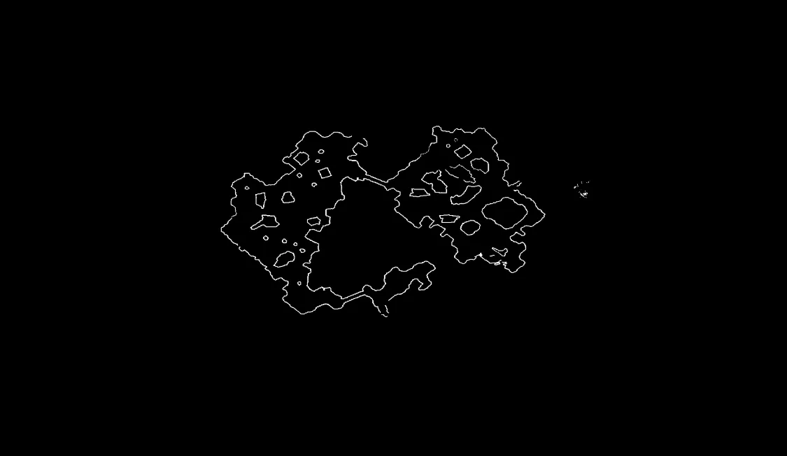
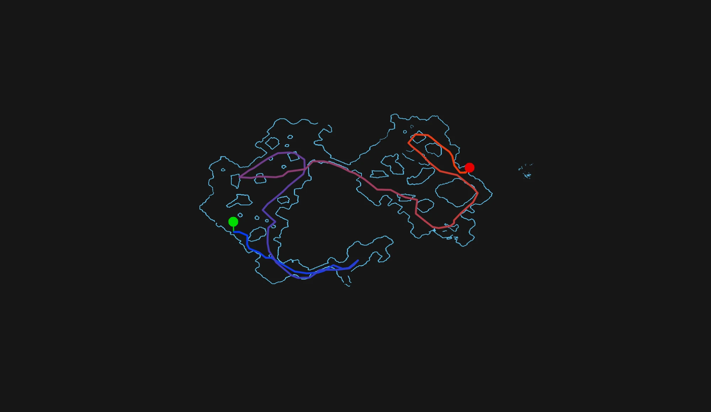
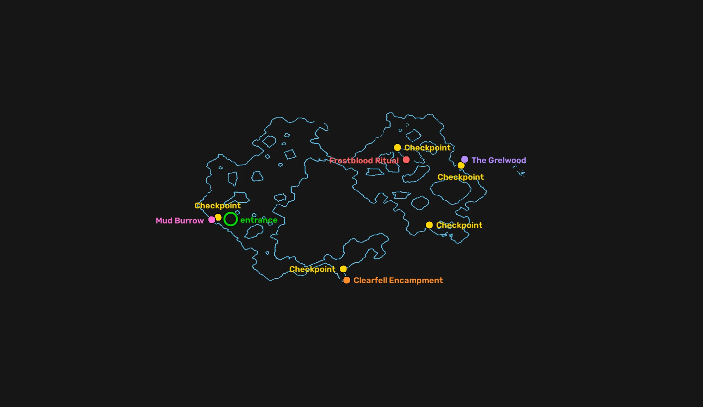
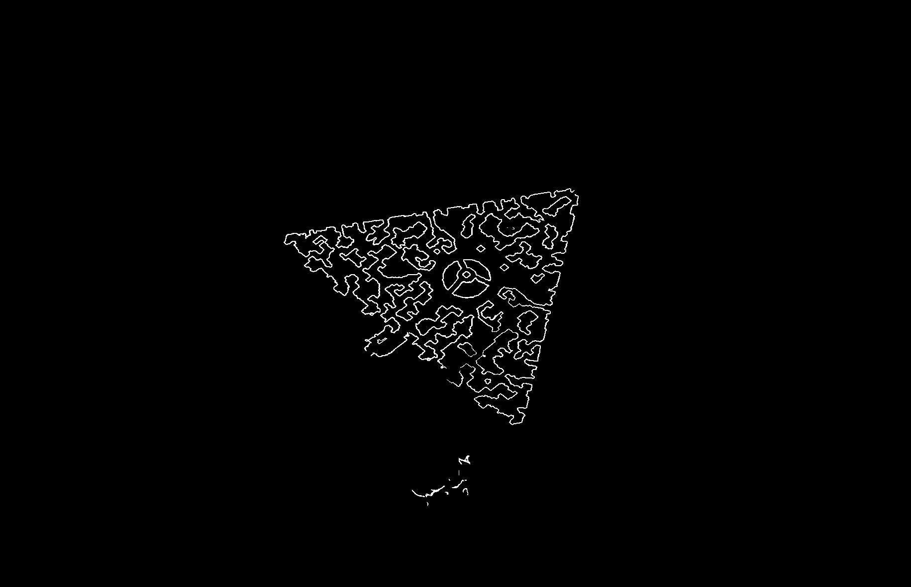
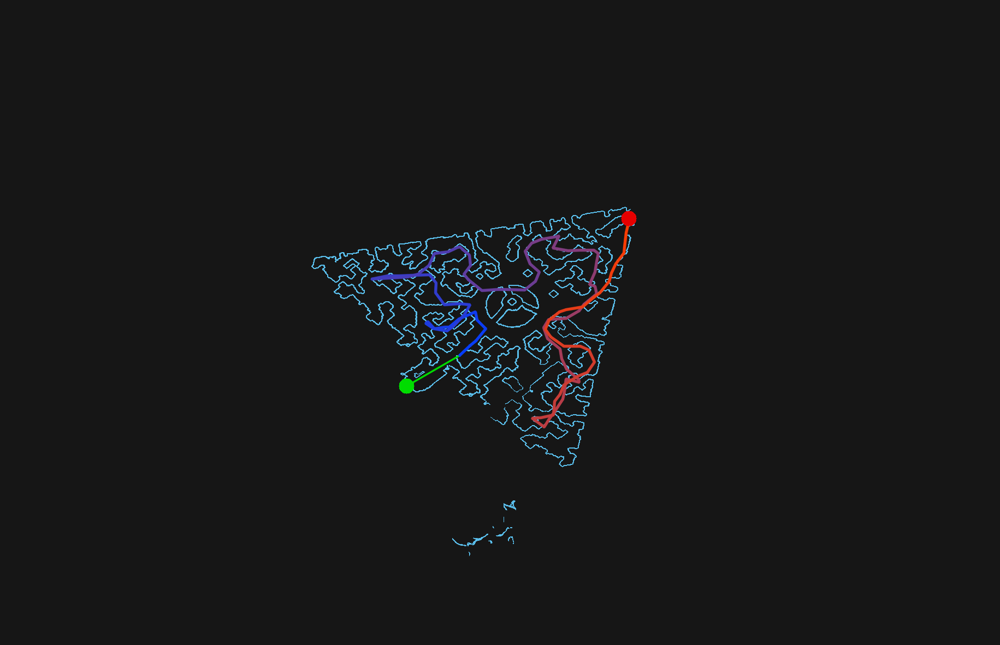
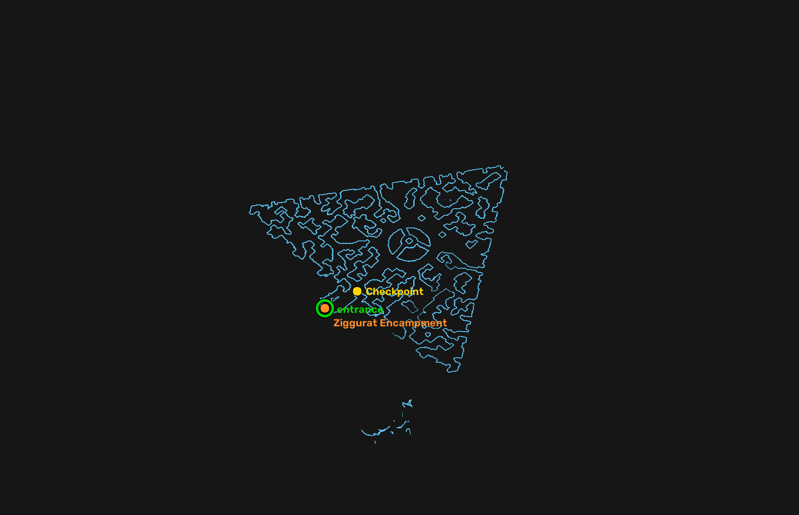
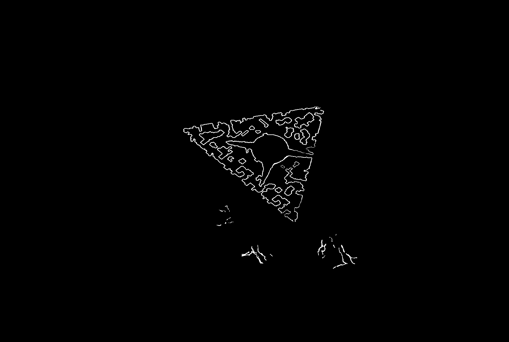
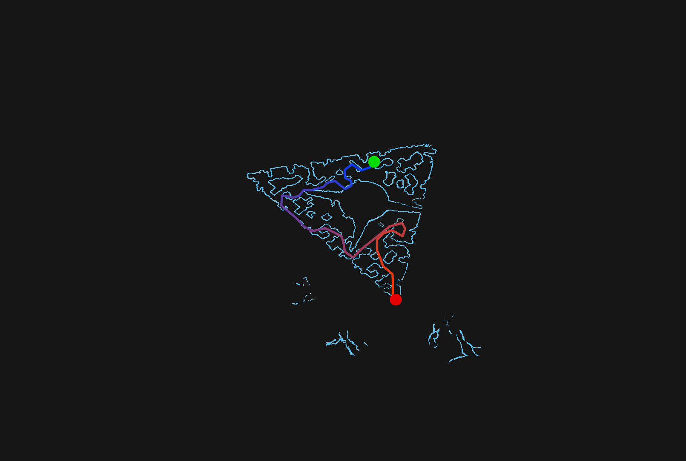
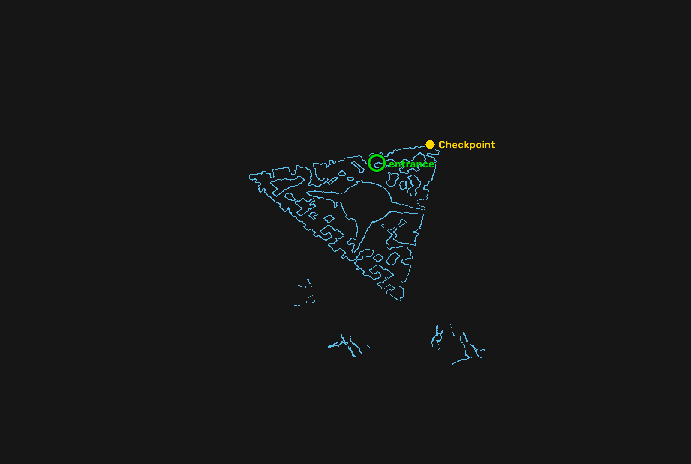
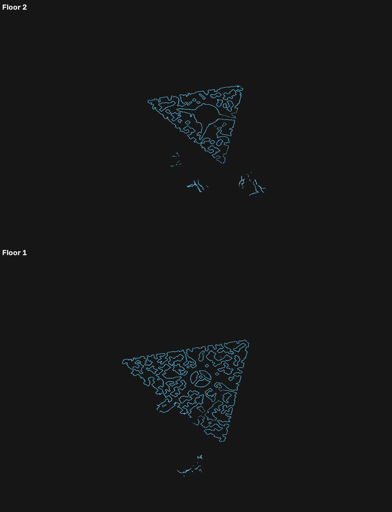

# PoE2 Layout Capture

Records Path of Exile 2 zones while you play: the **layout** of the zone (from the Tab map), the **route you
walked** and the **labels** shown on the map (Checkpoint, Waypoint, gates, bosses, ...). Each zone instance is
saved as one run, and runs of the same zone are grouped into layouts.

It only records the screen and reads the game's own log file (`Client.txt`). It never touches game memory, and
it never runs OCR on the live game: text is only read from the recorded videos, after the zone is finished.

## Start

```
run.bat            capture while you play
analyze.bat        only analyze the videos left in the video folder
```

The first start creates `.venv` (Python 3.14) and installs `requirements.txt`; when `requirements.txt` changes,
the next start installs it again. Play in **Windowed Fullscreen** and keep the **Tab map** open while you
explore. Turn off blue-light filters (f.lux, Windows Night Light) while filming: their warm tint can hide most
of the blue map outline. A line in the console shows the zone, how much has been filmed and how far the
analysis is.

Nothing is filmed until you press **ctrl+alt+r** (`hotkeys.record`), and pressing it again ends the recording
and hands the video to the analysis. While it's on, each new zone still gets its own video. To film every zone
you enter automatically instead, set `"recorder": {"manual": false}`.

**ctrl+alt+p** (`hotkeys.pause`) pauses filming without ending the video, and pressing it again goes on with the
same video. The analysis treats the pause like a town trip and finds your position again afterwards.

Stop with **Ctrl+C** in the console or **ctrl+alt+q** (works while the game has focus). The zone you are in and
any videos still waiting are analyzed before the program exits; press Ctrl+C again to skip that. Videos that were
not analyzed stay in the video folder and are analyzed on the next start. Only one capture can run at a time.

## Settings

Copy `config.example.json` to `config.json` and change what you need; every key you leave out keeps its
default. `config.json` is your own file and is not in git. Unknown keys are reported in the log, wrong values
stop the program with a message.

| Key | Default | Meaning |
|-----|---------|---------|
| `monitor` | `1` | monitor the game runs on (1 = main) |
| `client_log` | found automatically | path to `Path of Exile 2/logs/Client.txt` |
| `poll_interval` | `0.4` | seconds between reads of the game log |
| `data_dir` | project folder | where `runs/`, `logs/`, `dataset/`, `videos/` and `learned_exits.json` go |
| `log_level` | `INFO` | `DEBUG` logs every frame decision of the map stitching |
| `debug_snapshots` | `false` | save frame + outline to `logs/snapshots` when tracking gets lost |
| `hotkeys.quit` | `ctrl+alt+q` | hotkey that stops the capture (letters, digits, F1-F24) |
| `hotkeys.record` | `ctrl+alt+r` | hotkey that starts and stops filming (unless `recorder.manual` is `false`) |
| `hotkeys.pause` | `ctrl+alt+p` | hotkey that pauses filming and goes on with the same video |
| `recorder.fps` | `2` | frames filmed per second |
| `recorder.video_dir` | `videos` | zone videos waiting for analysis (relative paths are inside `data_dir`) |
| `recorder.video_codec` | `HFYU` | `HFYU` (fast to write) or `FFV1` (about 20% smaller, slower) |
| `recorder.min_free_gb` | `20` | filming pauses when the video disk has less free space than this |
| `recorder.manual` | `true` | only film between presses of `hotkeys.record`; `false` films every zone you enter |
| `analysis.ocr_every` | `1.0` | seconds of video between label reads |
| `analysis.keep_instances` | `2` | analyzed instances kept in memory, so coming back to one continues its map |
| `analysis.map_area` | built in | screen polygon the Tab map is read from (screen fractions) |
| `training_frames.enabled` | `false` | keep raw frames of the zone videos for training (see below) |
| `training_frames.every` | `4.0` | seconds of video between kept frames |
| `training_frames.max_mb` | `3000` | stop keeping frames above this |
| `training_frames.jpeg_quality` | `95` | |

The log is written to `logs/capture.log` (5 MB, the last 5 kept). The status line is only shown in the console.

## What happens

1. **Zone detection** (`detector.py`, `gamelog.py`): zone changes come from `Client.txt`: the zone name, the
   game's zone code and the seed. Zone code + seed identify the **instance**, so going back through a portal
   continues the same map: a trip to town only pauses the zone's video, and the zone counts as finished once
   you enter a different one.
2. **Filming** (`recorder.py`): twice a second the screen is written to a lossless video of this zone visit,
   only while the game is in front on the filmed monitor (`monitor` in `config.json`); towns and hideouts are
   not filmed. Next to it a `.jsonl` file (the visit
   file) holds the zone, the instance, the zone you came from and each frame's time.
   Lossless because ordinary video compression wipes out much of the thin blue map outline. That costs disk
   space while the zone is played (roughly 5 MB per frame at 1440p, so 10 minutes are about 6 GB).
3. **Analysis** (`analyzer.py`): when you end the video, the finished video is analyzed in the background,
   one video after another:
   - **Layout**: the blue outline of the Tab map in every frame (`outline.py`) is stitched into one map of the
     zone (`stitcher.py`).
   - **Route**: the position on that map in every frame: the middle of the screen, or of the part still
     visible when a side panel (inventory, skills, market) is open - the game moves the view sideways then.
     The open panel itself is not read as map.
   - **Labels** (`labels.py`): about once a second (video time) the map labels are read with Windows OCR and
     matched against the zone's names: Checkpoint, Waypoint, its gates and points of interest from
     `data/zones.json`, the gate of the zone you came from, and gates learned while you play (see below).
     A label counts once it has been read at the same spot several times. Text that stays at one spot on the
     screen while you walk, in the quest tracker for example, gets left out. 
4. **Saving** (`library.py`): the run is saved, sorted into a layout (`layouts.py`), and the video is deleted.
   A video whose analysis fails, or of which less than half the frames in its visit file can be read (a
   crash while filming), is moved to `<video_dir>/failed/` so it isn't retried on every start.

### Zones not in `data/zones.json`

New zones work without any setup: the zone name is taken from the game log, and the map, route and layouts
don't depend on zone data. Only the labels need names to look for. When the gate named after the zone you came
from is read at the entrance (so you really walked through it, not a waypoint or portal), both zones are noted
as each other's gate in `learned_exits.json`, and their gate labels are read from then on. Points of interest
(bosses, quest spots) of unknown zones are not recognised until they are added to `data/zones.json`.

## Output

```
runs/<Zone>/<instance id>/        e.g. runs/Clearfell/G1_2_1628456714
    map.png          the stitched layout (white = walls/outline)
    meta.json        see below
    path.png         the route drawn on the map, for looking at; gaps where it isn't known (teleports, frames
                     the map couldn't be placed for a few seconds)
    labels.png       the labels on the map, one colour per name, green ring = entrance
    map_floor2.png   zones with several floors (Temple of Kopec): the other floors, in the order reached,
    path_floor2.png  each with its own route and labels picture
    labels_floor2.png
    floors.png       ... and all floors stacked, the first at the bottom
runs/<Zone>/layouts.json   instance id -> layout letter, orientation, mirrored
```

A run of Clearfell, as saved:

| `map.png` | `path.png` | `labels.png` |
|---|---|---|
|  |  |  |

The route goes from blue (where the map began) to red (where you left), and the green dot is the entrance.
The labels show the zone's gates (Clearfell Encampment, The Grelwood), its points of interest and the
Checkpoints.

Run folders are named by the **instance id** (zone code + seed), which never changes. Which layout a run belongs
to is kept only in `layouts.json`, because layouts can merge when a later run shows that two of them are one:

```
"G1_3_1608916677": {"layout": "A", "orientation": "flip_h", "mirrored": true}
```

`meta.json` (`"version": 2`):

| Key | Meaning |
|-----|---------|
| `zone`, `instance`, `zone_code`, `seed` | which zone and instance |
| `came_from` | the zone you were in before |
| `scale`, `frames` | map pixels per screen pixel, frames placed on the map |
| `screen` | `[width, height]` of the filmed screen; runs of different sizes are never grouped together (missing in runs saved before it was recorded: compared with all) |
| `first_point` | where the map began (a few seconds after you came in) |
| `entrance` | where you came in (the gate or Waypoint label near the first point) |
| `labels` | every label read: `text`, `x`, `y`, `hits` (times read), `looks` (reads that had its spot on screen) |
| `path` | the route, thinned to at most ~300 points |
| `path_t` | tick of each `path` point: one per filmed frame, more across a gap in the video; a bigger step than usual means time without a position (missing in runs saved before it was kept) |
| `other_floors` | floors 2, 3, ...: `map` (file name), `frames`, `labels`, `path`, `path_t` in pixels of that floor's map |

Coordinates are pixels of `map.png`.

### Zones with several floors

Some zones (Temple of Kopec) have floors that the game log doesn't mention: the stairs only fade the screen to
black, then the Tab map shows the next floor. A black screen ends the current map piece; when the map after it
never fits the earlier one, it is another floor, and every floor with at least 30 frames is saved. A teleport
on the same floor (checkpoint) also fades to black, but its map is put back together with the rest. Only the
first floor (`map.png`, where you came in) is used for grouping runs into layouts.

A run of Temple of Kopec with two floors:

| | `map` | `path` | `labels` |
|---|---|---|---|
| Floor 1 |  |  |  |
| Floor 2 |  |  |  |

On floor 2 the green dot is where you arrived from the stairs. `floors.png` shows both floors stacked:



Runs are grouped into layouts by comparing their maps, also mirrored and rotated (the game shows some layouts
flipped). Two runs count as the same layout only when their outlines agree and their overall shapes overlap
too: zones built from shared pieces (a town, reused rooms) otherwise match on one common part. `orientation`
says how a run's map is turned against the first run of its layout:

| Orientation | Meaning | Mirrored |
|-------------|---------|----------|
| `id` | same way round | no |
| `flip_h` | mirrored left-right | yes |
| `flip_v` | mirrored top-bottom | yes |
| `rot180` | turned 180° | no |
| `rot90` / `rot270` | turned a quarter (in the game world) | no |
| `diag` / `anti_diag` | mirrored along a diagonal (in the game world) | yes |

The Tab map squashes the ground vertically, so quarter turns and diagonal mirrors are not plain image
rotations.

## Training data (optional)

With `training_frames.enabled`, the analysis keeps a raw frame of the zone video in
`dataset/<Zone>/<instance id>/` every `training_frames.every` seconds, up to `training_frames.max_mb`, with
`frames.jsonl` describing each frame (map position, stitching result).

## Words used in the code

| Word | Meaning |
|------|---------|
| zone | an area of the game, by name ("Clearfell") |
| zone code | the game's code for it ("G1_2") |
| instance | one generated copy of a zone: zone code + seed, id `G1_2_1628456714` |
| visit | one stay in an instance, filmed as one video (a trip to town pauses it) |
| run | the saved result of an instance: `runs/<zone>/<instance id>/` |
| label | a name shown on the Tab map (Waypoint, a gate, a boss) |
| gate | a passage to another zone; its label is that zone's name |
| piece | part of a map the stitcher could not yet connect to the rest |
| layout | runs whose maps are the same zone layout (letters A, B, ...) |

## Development

```
.venv\Scripts\python -m pip install -r requirements-dev.txt
.venv\Scripts\python -m pytest
.venv\Scripts\python -m ruff check .
```

The code is the `poe2layout` package (`python -m poe2layout [capture|analyze]`); the tests in `tests/` use
synthetic maps and a few real frames (`tests/frames/`), and need neither the game nor OCR. GitHub Actions runs
the tests and ruff on every push to `main` and `dev` (`.github/workflows/tests.yml`).
